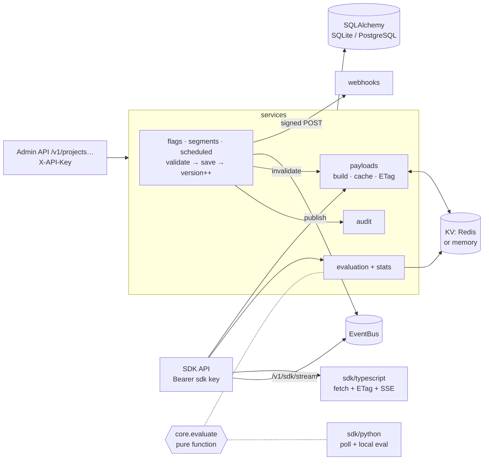

<!-- topics: feature-flags,remote-config,fastapi,python,typescript,sdk,rollout,targeting,sse,redis,sqlalchemy -->
# feature-flags-service

A feature flag and remote config service: boolean and multivariate flags with attribute, regex and semver targeting, sticky percentage rollouts, reusable segments, per-environment configs with a kill switch, scheduled changes, a full audit trail, ETag-cached bulk payloads and a Server-Sent Events stream, plus a Python server SDK and a typed TypeScript client SDK.

[](https://github.com/AkibUllah/feature-flags-service/actions/workflows/ci.yml)


## Why this exists

Shipping a new checkout to a retail platform or a new KYC flow to a wallet app is never "deploy and hope": you want it on for staff first, then 5% of Dhaka users on app version 2.4 or newer, then everyone, and you want one button that turns it off at 2am without a rollback. Every team I have worked with ends up with a `settings` table and a cache that is wrong on half the servers. This service is that table done properly: evaluation is a pure function over a versioned payload, so the server, the Python SDK and your tests all agree on what a user sees; clients learn about changes within a second over SSE; and every change says who did it, what it was before and what it is now.

## Features

- Projects with environments (dev / staging / prod by default), hashed server and client SDK keys with revocation and last-used tracking
- Flags of kind `boolean`, `string`, `number` or `json` with named variations; per-environment config (enabled, individual targets, rules, fallthrough, off variation) so prod and staging differ without copying flags
- Targeting clauses: `eq`, `neq`, `in`, `contains`, `starts_with`, `ends_with`, `regex`, numeric `gt/gte/lt/lte`, `semver_eq/gt/gte/lt/lte`, `exists`, `in_segment`, each negatable; list-valued attributes match on any element
- Percentage rollouts with sticky bucketing (SHA-256 of flag + salt + user key, optional `bucket_by` attribute); verified to stay within 2% of the configured split over 100,000 keys
- Segments (included / excluded keys + rules) shared across a project and referenced from rules; deletion is refused while a flag uses them
- Kill switch (`/kill`, `/restore`) that serves the off variation without losing the rules; scheduled changes applied by a background sweep or on demand
- `POST /v1/evaluate` for one or many flags with a reason (`OFF`, `TARGET_MATCH`, `RULE_MATCH` + rule id, `FALLTHROUGH` + rollout, `ERROR`); usage counters per flag, environment, variation and reason
- `GET /v1/sdk/flags` bulk payload with strong ETags and `304 Not Modified`; server keys get full targeting for local evaluation, client keys get values evaluated for their context so rules never reach a browser
- `GET /v1/sdk/stream` Server-Sent Events with coalesced `put` events and keep-alive comments
- Audit log (actor, action, before/after) for every change; HMAC-signed flag-change webhooks
- Redis for the payload cache and counters with a transparent in-memory fallback; SQLite for dev/tests, PostgreSQL + Redis via docker compose
- `sdk/python` (polling with ETag, local evaluation, thread-safe) and `sdk/typescript` (fetch + ETag, SSE, change events, bootstrap values; ESM + CJS + types via tsup)

## Architecture



Design notes:

- **Evaluation is pure.** `core.evaluate.evaluate(flag_payload, context, segments)` has no I/O. The HTTP layer, the Python SDK and the 100k-key distribution test all call the same function, so there is exactly one definition of "what does this user get".
- **Versions drive everything.** Each change bumps `FlagConfig.version` and the owning `Environment.version`. The payload cache key includes the environment version (so invalidation is a key change, not a race), the ETag is a hash of the payload, and SSE subscribers ignore events older than what they already sent.
- **Precedence is fixed:** kill switch → individual targets → rules in order → fallthrough. Structural mistakes (a rule pointing at a deleted variation) are rejected on save, and if one slips through the evaluator returns the off variation with reason `ERROR` rather than raising into a request path.
- **Client keys never see rules.** The same payload builder produces either the full config (server keys) or per-context evaluated values (client keys); the ETag for client payloads mixes in the context so two users never share a cached response.
- **Time is injected.** Scheduled changes, audit timestamps and SDK-key usage all read the app clock; tests advance a `FixedClock` to make a change due.
- **Redis is optional.** `KV` is a small protocol with Redis and memory implementations; a single instance runs with no Redis at all, and tests use `fakeredis`.

## Tech Stack

| Layer | Choice |
| --- | --- |
| API | FastAPI, Pydantic v2, `StreamingResponse` for SSE |
| Persistence | SQLAlchemy 2.0; SQLite (dev/tests), PostgreSQL 16 (compose, psycopg 3) |
| Cache / counters | Redis 7 via `redis-py`, in-memory fallback, `fakeredis` in tests |
| Python SDK | httpx, threading; shares `feature_flags.core` for evaluation |
| TypeScript SDK | TypeScript 5.4 strict, tsup 8 (ESM + CJS + d.ts), vitest 1.6, ESLint |
| Tooling | pytest + coverage, ruff, Makefile, GitHub Actions (Python 3.10/3.11, Node 18/20, docker build) |

## Quick Start

### Docker Compose (API + PostgreSQL + Redis)

```bash
git clone https://github.com/AkibUllah/feature-flags-service.git && cd feature-flags-service
cp .env.example .env
docker compose up --build -d
curl -s localhost:8000/health
```

### Local (SQLite, in-memory cache)

```bash
make install          # venv + service + Python SDK + npm ci for the TS SDK
make dev              # http://127.0.0.1:8000, docs at /docs
```

Create a project and a flag, target Bangladesh users on app 2.4+, roll out to 20% of everyone else:

```bash
export KEY=change-me   # ADMIN_API_KEY from .env (leave empty to disable auth locally)
H=(-H "X-API-Key: $KEY" -H "X-Actor: akib" -H "Content-Type: application/json")

curl -s -X POST localhost:8000/v1/projects "${H[@]}" -d '{"key":"shop","name":"Shop"}'

curl -s -X POST localhost:8000/v1/projects/shop/flags "${H[@]}" -d '{
  "key":"new-checkout","name":"New checkout","kind":"boolean",
  "variations":[{"key":"on","value":true},{"key":"off","value":false}]}'

curl -s -X PATCH localhost:8000/v1/projects/shop/flags/new-checkout/environments/prod "${H[@]}" -d '{
  "enabled": true,
  "targets": [{"variation":"on","keys":["staff_akib"]}],
  "rules": [{"id":"bd-modern","clauses":[
      {"attribute":"country","op":"eq","values":["BD"]},
      {"attribute":"app_version","op":"semver_gte","values":["2.4.0"]}],
    "variation":"on"}],
  "fallthrough": {"rollout":[{"variation":"on","weight":20000},{"variation":"off","weight":80000}]}}'

curl -s -X POST localhost:8000/v1/projects/shop/environments/prod/sdk-keys "${H[@]}" \
  -d '{"kind":"server","name":"backend"}'            # -> {"key":"srv-…"} shown once

curl -s -X POST localhost:8000/v1/evaluate -H "Authorization: Bearer srv-…" -H "Content-Type: application/json" \
  -d '{"context":{"key":"user_42","attributes":{"country":"BD","app_version":"2.5.1"}},"flag":"new-checkout"}'
# {"flag_key":"new-checkout","variation":"on","value":true,
#  "reason":{"kind":"RULE_MATCH","rule_id":"bd-modern","rule_index":0},"version":2}

curl -s -X POST localhost:8000/v1/projects/shop/flags/new-checkout/environments/prod/kill "${H[@]}"
curl -sN localhost:8000/v1/sdk/stream -H "Authorization: Bearer srv-…"      # SSE: event: put …
```

### SDKs

Python (server-side, local evaluation):

```python
from flagclient import FlagClient

flags = FlagClient("srv-…", "http://localhost:8000", poll_interval=30)
flags.start_polling()
if flags.is_enabled("new-checkout", {"key": user.id, "country": "BD", "app_version": "2.5.1"}):
    ...
```

TypeScript (browser / Node, values evaluated server-side for the given context):

```ts
import { FlagClient } from "feature-flags-client";

const flags = new FlagClient({ baseUrl, sdkKey: "cli-…", context: { key: user.id, attributes: { country: "BD" } } });
await flags.init();                          // fetch + SSE
flags.isEnabled("new-checkout");
flags.on("change", (keys) => rerender(keys));
```

## API

Management routes require `X-API-Key` (when `ADMIN_API_KEY` is set) and accept `X-Actor` for the audit log. SDK routes take `Authorization: Bearer <sdk key>` or `X-SDK-Key`. Errors are `{"error": {"code", "message"}}`.

| Method | Path | Purpose |
| --- | --- | --- |
| `POST` · `GET` | `/v1/projects` · `/v1/projects/{p}` | Create (with default or custom environments) / list / fetch |
| `POST` | `/v1/projects/{p}/environments` | Add an environment |
| `POST` · `GET` · `DELETE` | `/v1/projects/{p}/environments/{e}/sdk-keys[/{id}]` | Create (plaintext shown once) / list / revoke |
| `POST` · `GET` | `/v1/projects/{p}/flags` | Create (kind, variations, tags) / list (`tag`, `include_archived`) |
| `GET` · `PATCH` · `DELETE` | `/v1/projects/{p}/flags/{f}` | Detail with all environment configs / metadata / archive |
| `GET` · `PATCH` | `/v1/projects/{p}/flags/{f}/environments/{e}` | Read / patch `enabled`, `off_variation`, `targets`, `rules`, `fallthrough` |
| `POST` | `…/environments/{e}/kill` · `/restore` | Kill switch on / off |
| `POST` · `GET` · `DELETE` | `…/environments/{e}/schedule` · `/flags/{f}/schedule[/{id}]` | Schedule a config patch / list / cancel |
| `POST` | `/v1/scheduled-changes/apply` | Apply due changes now |
| `GET` | `/v1/projects/{p}/flags/{f}/stats` | Evaluation counts per environment, variation and reason |
| `POST` · `GET` · `PATCH` · `DELETE` | `/v1/projects/{p}/segments[/{s}]` | Reusable rule groups |
| `GET` | `/v1/projects/{p}/audit` | Who changed what (`entity_type`, `entity_id` filters) |
| `POST` · `GET` · `DELETE` | `/v1/projects/{p}/webhooks[/{id}]` | Signed flag-change notifications (`X-Flags-Signature`) |
| `POST` | `/v1/evaluate` | `{context, flag}` → one result; `{context, flags?}` → list |
| `GET` | `/v1/sdk/flags` | Bulk payload, `ETag` / `If-None-Match`; client keys pass `?context=<base64url JSON>` |
| `GET` | `/v1/sdk/stream` | SSE `put` events; `?max_events=` for scripts |
| `GET` | `/health` | DB, cache backend, SSE subscriber count, clock |

## Project Structure

```
feature_flags/
├── main.py                 # app factory: create_app(settings, clock=, kv=, transport=)
├── clock.py · config.py · database.py · kv.py · models.py · schemas.py
├── core/                   # pure, shared with the Python SDK
│   ├── evaluate.py         # precedence, reasons, error fallback
│   ├── clauses.py          # operators, Context
│   ├── bucketing.py        # sticky rollouts
│   ├── semver.py · signing.py
├── services/
│   ├── flags.py            # create / config patch / kill / archive
│   ├── segments.py · scheduled.py · projects.py (keys) · webhooks.py
│   ├── payloads.py         # payload build, cache, ETag, client view
│   ├── evaluation.py · stats.py · audit.py · bus.py · validation.py
└── api/                    # admin.py, sdk.py (evaluate, flags, stream)
sdk/python/flagclient/      # FlagClient: refresh/poll with ETag, variation(), all_flags()
sdk/typescript/src/         # FlagClient: init/identify/on('change'), SSE, bootstrap
tests/                      # 83 service tests · sdk/python/tests: 6 · sdk/typescript/tests: 13
```

## Testing

```bash
make test        # 89 Python tests (service + Python SDK), in-memory SQLite + fakeredis
make cov         # with coverage (94% at the time of writing)
make lint        # ruff
make sdk-ts      # eslint + tsc --noEmit + vitest (13 tests) + tsup build
```

Covered: semver parsing and ordering incl. pre-releases; every clause operator, negation, list attributes and missing attributes; bucketing determinism, decorrelation across flags/salts, `bucket_by`, and the 10/30/60 split within 2% over 100k keys; evaluator precedence, segments (include/exclude/rules/negated), rollouts, multivariate values and error fallback; KV backends (memory + fakeredis) and usage counters; project/environment/SDK-key lifecycle with hashing and revocation; config validation errors; version bumps, cache invalidation and audit before/after; kill switch; segment effects on all environments and in-use protection; scheduled changes applied only when due and never twice; signed webhooks incl. failure recording; the SSE generator (initial put, heartbeat, coalescing, stale events, disconnect) and the HTTP stream; the full HTTP API including ETag/304 for server and client keys, context encoding, stats and auth; the Python SDK (ETag round trip, errors keep last payload, callbacks); the TypeScript SDK (encoding, bootstrap, ETag, change diffing, SSE put/error, identify, polling timers, unsubscribe).

## Roadmap

- Redis pub/sub behind `EventBus` so SSE works across several API replicas
- Prerequisite flags (flag B only on when flag A is on) and experiment allocation with holdouts
- Alembic migrations (schema is created with `create_all` today)
- Per-key rate limiting on `/v1/evaluate` and payload compression for very large projects
- A small React admin UI over the management API

## License

MIT — see [LICENSE](LICENSE).
